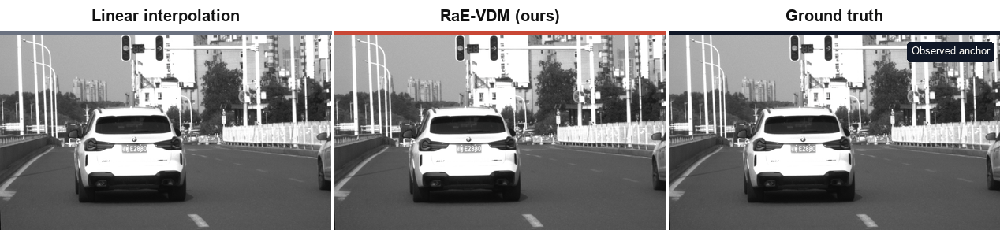

# RaE-VDM

Official research code for reliability-aware, event-guided intensity video
interpolation with a conditional video diffusion prior, flow fusion, and
occlusion-aware refinement.

This repository contains model, training, evaluation, and inference code.
Datasets, pretrained checkpoints, logs, paper figures, and figure-generation
scripts are intentionally not included. The small `assets/` directory contains
only the source-resolution comparison used in this README.

## Highlights

- RLED H5 reader for grayscale frames and asynchronous events.
- Reliability- and observability-aware event representation.
- Conditional 3D U-Net diffusion prior for intermediate-frame prediction.
- Residual correction, frozen RAFT flow fusion, and occlusion refinement.
- Single-GPU and distributed training.
- Center-crop and tiled full-resolution inference.

## Full-Resolution Demo



The frozen final checkpoint predicts five intermediate frames from two shared
endpoint frames and the intervening event stream. This RLED example is inferred
over the complete **1120 x 660** field of view using overlapping 256 x 256
tiles; it is not a resized 256 x 256 test.

| Method | PSNR (dB) | MAE | Temporal MAE |
|---|---:|---:|---:|
| Linear interpolation | 18.74 | 0.0598 | 0.0469 |
| **RaE-VDM (ours)** | **29.61** | **0.0166** | **0.0229** |

The first and last animation frames are observed anchors. Frames 1--5 are
unseen intermediate frames. Open the
[300 dpi comparison poster](assets/demo_fullres_poster.png) or
[high-resolution video](assets/demo_fullres_comparison.mp4) for closer
inspection. Exact values and protocol metadata are stored in
[`assets/demo_metrics.json`](assets/demo_metrics.json).

## Repository Layout

```text
assets/                               README demo GIF, MP4, poster, and metrics
configs/                              Training and inference configurations
docs/                                 Theory-to-code notes
src/raevdm/                           Core package
tools/                                Dataset inspection utilities
training/stages/                      Final-model training stages
train.py                              Standard training entry point
infer.py                              Standard inference entry point
evaluate.py                           Standard evaluation entry point
train_pipeline.py                     End-to-end final training launcher
infer_local.py                        Final-model local inference
infer_full_resolution.py              Tiled native-resolution inference
```

## Installation

Python 3.9 or newer is required. Install a CUDA-enabled PyTorch build that
matches your driver first, then install this package:

```bash
git clone <repository-url> RaE-VDM
cd RaE-VDM
python -m pip install -e .
```

The equivalent dependency-only command is:

```bash
python -m pip install -r requirements.txt
```

## Data

RLED H5 files are expected to contain:

```text
events/xs, events/ys, events/ts, events/ps
images/image000000000, images/image000000001, ...
image attributes: event_idx, size, timestamp
optional: event_indices
```

Inspect a dataset before training:

```bash
python tools/inspect_rled_h5.py --root /path/to/RLED
python tools/check_event_representation.py --h5 /path/to/sample.h5
```

Set `data.root` in a YAML config, or pass `--data-root` to the staged launcher.
No RLED files are distributed in this repository.

## Checkpoints

Model weights are not stored in Git. See [MODEL_ZOO.md](MODEL_ZOO.md) for the
expected filenames and placement. The released final checkpoint is compatible
with `configs/inference.yaml`.

RAFT-Small weights are also excluded. The staged geometry scripts expect the
official torchvision file `raft_small_C_T_V2-01064c6d.pth` in the repository
root, or a path supplied through `RAE_RAFT_WEIGHTS`.

## Inference

The final flow/occlusion model uses RAFT-assisted inference. Set the three
paths and run the local entry point:

```bash
export RAE_CONFIG=configs/inference.yaml
export RAE_CHECKPOINT=/path/to/FINAL_BEST_INFERENCE.pt
export RAE_RAFT_WEIGHTS=/path/to/raft_small_C_T_V2-01064c6d.pth
export RAE_TEST_H5=/path/to/sample.h5
python infer_local.py
```

For native-resolution inputs, use tiled inference:

```bash
python infer_full_resolution.py --num-samples 8
```

`infer_local.py` can also be run without environment variables: edit its
checkpoint and H5 defaults near the top of the file, then run it from an IDE.
The lightweight `infer.py` entry point is retained for diffusion-core
checkpoints that do not use the RAFT geometry stages.

## Standard Training

Run a quick data/model validation first:

```bash
python train.py --config configs/train_core.yaml --smoke
```

Single GPU:

```bash
python train.py --config configs/train_core.yaml
```

Two GPUs:

```bash
torchrun --standalone --nproc_per_node=2 train.py \
  --config configs/train_core.yaml
```

Resume without overwriting the source checkpoint:

```bash
torchrun --standalone --nproc_per_node=2 train.py \
  --config configs/train_core.yaml \
  --resume /path/to/latest.pt
```

## Complete Staged Training

The staged launcher trains the diffusion core and then runs residual
correction, flow fusion, occlusion refinement, and final joint tuning. Each run
receives a timestamped output directory, so existing checkpoints are not
overwritten.

```bash
python train_pipeline.py \
  --variant full \
  --data-root /path/to/RLED/train \
  --gpus 0,1 \
  --stage all
```

The final inference-only checkpoint is written as
`FINAL_BEST_INFERENCE.pt` inside the final stage's `checkpoints/` directory.

Useful environment variables for individual geometry stages:

```text
RAE_DATA_ROOT          RLED training directory
RAE_RESUME_CHECKPOINT  Warm-start checkpoint
RAE_RAFT_WEIGHTS       Official RAFT-Small weight file
RAE_OUTPUT_DIR         Output root
RAE_RUN_PREFIX         Unique run-name prefix
RAE_GPU_IDS            Comma-separated CUDA device IDs
```

## Evaluation

```bash
python evaluate.py \
  --config configs/train_core.yaml \
  --checkpoint /path/to/core_checkpoint.pt \
  --sampling-steps 50
```

This compact evaluator covers the diffusion core. Paper-specific benchmark
and figure-generation programs are intentionally excluded from this release.

## Reproducibility Notes

- The final model uses 7-frame clips with endpoint anchors and predicts five
  intermediate frames.
- Training crops are 256 x 256. Native-resolution inference uses overlapping
  tiles rather than resizing the whole frame to 256 x 256.
- Checkpoints save model, EMA, optimizer metadata, epoch, step, and config.
- The compact final inference checkpoint contains EMA model weights and config
  but omits optimizer state.

## License

Code is released under the MIT License. Third-party datasets and pretrained
weights remain subject to their original licenses.
