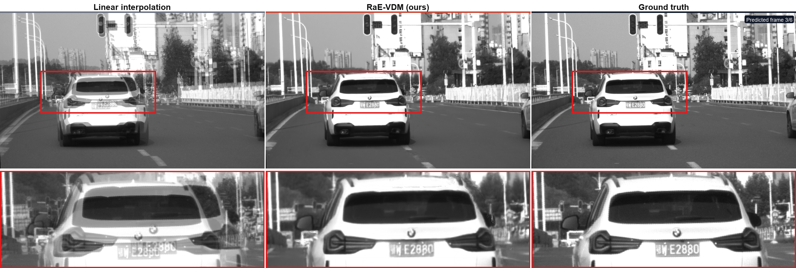

# RaE-VDM

Official research code for reliability-aware, event-guided intensity video
interpolation with a conditional video diffusion prior, flow fusion, and
occlusion-aware refinement.

This repository contains model, evaluation, and inference code.
Datasets, pretrained checkpoints, logs, paper figures, and figure-generation
scripts are intentionally not included. The small `assets/` directory contains
only the source-resolution comparison used in this README.

## Highlights

- RLED H5 reader with timestamp-aware event voxelization and polarity-specific thresholds.
- Reliability- and observability-aware conditioning with count-domain residual gates.
- Conditional 3D U-Net diffusion prior for intermediate-frame prediction.
- Residual correction, frozen RAFT flow fusion, and occlusion refinement.
- Deterministic interpolation and tiled native-resolution inference.
- Sequence-balanced evaluation on intermediate frames and synthetic regression tests.

## Full-Resolution Demo


This demo was generated with the previous released checkpoint and is retained
for reference; it is not a new measurement of the updated implementation.
It predicts five intermediate frames from two shared endpoint frames and the
intervening event stream. This RLED example is inferred
over the complete **1120 x 660** field of view using overlapping 256 x 256
tiles; it is not a resized 256 x 256 test.



The first and last animation frames are observed anchors. Frames 1--5 are
unseen intermediate frames. Open the
[high-resolution video](assets/demo_fullres_comparison.mp4) for closer
inspection. Exact values and protocol metadata are stored in
[`assets/demo_metrics.json`](assets/demo_metrics.json).

## Repository Layout

```text
assets/                               README demo GIF, MP4, poster, and metrics
configs/                              Model and inference configurations
docs/                                 Theory-to-code and migration notes
src/raevdm/                           Core package
src/raevdm/data/                      RLED reader and event voxelization
tests/                                Data, model, equations, and CLI checks
tools/                                Dataset and implementation checks
infer.py                              Standard inference entry point
evaluate.py                           Standard evaluation entry point
infer_local.py                        Final-model local inference
infer_full_resolution.py              Tiled native-resolution inference
```

## Installation

Python 3.10 or newer is required. Install a CUDA-enabled PyTorch build that
matches your driver first, then install this package:

```bash
git clone https://github.com/chengchen512/RaE-VDM.git
cd RaE-VDM
python -m pip install -e .
```

The equivalent dependency-only command is:

```bash
python -m pip install -r requirements.txt
```

## Data

RLED H5 files are expected to contain:

```text
events/xs, events/ys, events/ts, events/ps
images/image000000000, images/image000000001, ...
image attributes: event_idx, size, timestamp
optional: event_indices
```

Inspect a dataset:

```bash
python tools/inspect_rled_h5.py --root /path/to/RLED
python tools/check_event_representation.py --h5 /path/to/sample.h5
```

Set `data.root` in a YAML config, or pass `--data-root` to the evaluator.
No RLED files are distributed in this repository.

## Inference

The final flow/occlusion model uses RAFT-assisted deterministic inference.
Provide the config, model checkpoint, local RAFT weights, and input H5 file:

```bash
python infer.py --config configs/inference.yaml \
  --checkpoint /path/to/FINAL_BEST_INFERENCE.pt \
  --raft-weights /path/to/raft_small_C_T_V2-01064c6d.pth \
  --h5 /path/to/sample.h5
```

For native-resolution inputs, use tiled inference:

```bash
python infer_full_resolution.py --config configs/inference.yaml \
  --checkpoint /path/to/FINAL_BEST_INFERENCE.pt \
  --raft-weights /path/to/raft_small_C_T_V2-01064c6d.pth \
  --h5 /path/to/sample.h5 --num-samples 8 --tile-size 256 --overlap 64
```

`infer_local.py` is a compatibility entry point to the same inference code.
Paths can also be supplied through `RAE_CONFIG`, `RAE_CHECKPOINT`,
`RAE_RAFT_WEIGHTS`, and `RAE_TEST_H5`. The checkpoint's saved architecture
determines which model stages are enabled. See [migration notes](docs/migration.md)
for compatibility and changed numerical behavior of older checkpoints.

## Evaluation

```bash
python evaluate.py \
  --config configs/inference.yaml \
  --checkpoint /path/to/FINAL_BEST_INFERENCE.pt \
  --raft-weights /path/to/raft_small_C_T_V2-01064c6d.pth \
  --data-root /path/to/RLED/test --tiled
```

Evaluation uses the shared deterministic inference path. PSNR, SSIM, and MAE
exclude the observed anchors; results are averaged within each sequence and
then across sequences. The JSON report also includes temporal error. LPIPS is
optional via `--lpips-weights` after installing `pip install -e ".[perceptual]"`.

## Implementation Checks

```bash
python -m pip install -e ".[test]"
python -m pytest -q
python tools/check_implementation.py --device cpu
```

These checks use synthetic inputs and do not establish dataset accuracy.

## Reproducibility Notes

- The final model uses 7-frame clips with endpoint anchors and predicts five
  intermediate frames.
- Native-resolution inference uses overlapping 256 x 256 tiles rather than
  resizing the whole frame to 256 x 256.
- The compact final inference checkpoint contains EMA model weights and config
  but omits optimizer state.

## License

Code is released under the MIT License. Third-party datasets and pretrained
weights remain subject to their original licenses.
